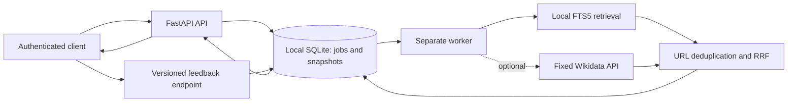
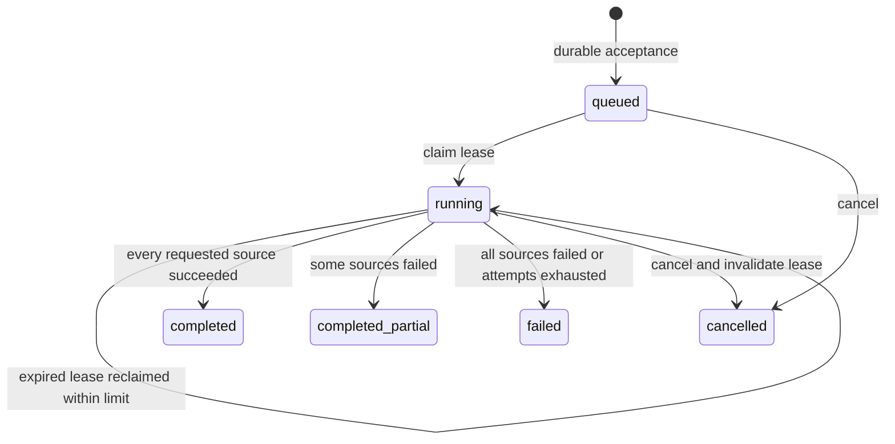
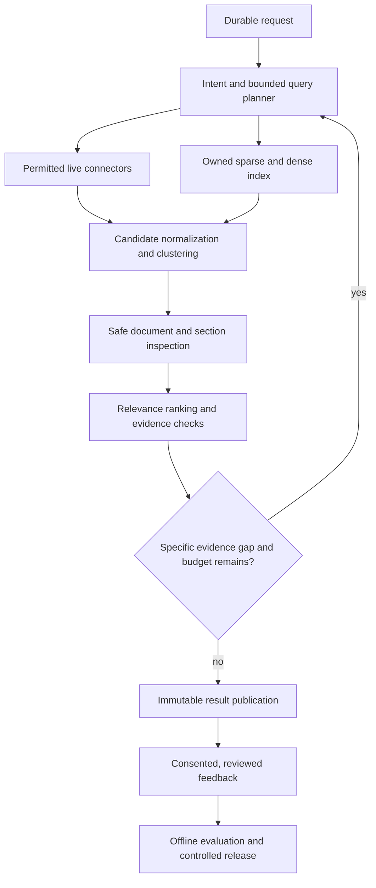

# Anvesha architecture

Architecture baseline: 2026-10-16. Task: **ANV-002**.

This document describes the staged design. The [task ledger](../tracking/tasks.json) and [handoff](../tracking/HANDOFF.md) are authoritative for implementation and verification status. [MVP_CONTRACT.md](MVP_CONTRACT.md) defines the shared M1 interfaces; [API.md](../API.md) documents actual HTTP behavior. Do not read future capabilities below as shipped functionality.

## Scope of the first executable slice

M1 establishes the complete asynchronous lifecycle on one machine with no paid API or LLM dependency. Python/FastAPI handles authenticated requests; a separate Python worker handles jobs. A local SQLite database holds durable job state, feedback, snapshots, and an FTS5 document index. Default retrieval is offline. An explicitly enabled Wikidata connector adds bounded entity metadata retrieval.

The bundled corpus contains clearly labelled first-party demonstration documents. Users may ingest documents they are entitled to use. This is not a general-web index, a semantic-search implementation, or evidence of Google-level quality. The initial live connector returns `metadata_only` results; it does not fetch or verify the linked entity pages.

| Concern | M1 boundary | Later capability |
| --- | --- | --- |
| Discovery | Local corpus; optional Wikidata entity metadata | Additional permitted sources and owned topical corpora |
| Retrieval | FTS5 lexical retrieval and source-rank fusion | Sparse/dense hybrid retrieval and measured reranking |
| Planning | Original request; bounded source calls | Intent routing, query decomposition, gap-driven investigation |
| Evidence | Local stored text or metadata-only labels | Safe fetching, extraction, passage-level provenance and support checks |
| Persistence | SQLite WAL on local disk | PostgreSQL and larger index when measured requirements justify them |
| Orchestration | Durable database queue with leases and bounded retries | Checkpointed multi-stage workflows, potentially a workflow engine |
| Results | One immutable terminal snapshot, version 1 | Intermediate immutable snapshots and incremental result delivery |
| Feedback | Authenticated, snapshot-bound storage | Reviewed, consented learning with offline evaluation and rollback |
| Operations | Local development baseline | Hosted quotas, automated retention, abuse controls, load/restore validation |

## Lifecycle invariants

1. Persist an accepted job before returning HTTP 202. An HTTP process restart must not erase accepted work.
2. A worker claims a job transactionally, receives a unique lease token, and performs external work outside database transactions.
3. Renew the lease between bounded stages. Expired jobs may be reclaimed until the retry ceiling; exhaustion becomes an explicit failure.
4. A worker may publish only while its token owns an unexpired lease on a running job. An old worker must not overwrite cancellation, deletion, or a new worker's result.
5. Persist final state and the result snapshot atomically. A successful empty snapshot is different from no snapshot.
6. Cancellation invalidates running work's publication right. Deletion removes associated snapshots and feedback and prevents stale publication.
7. All reads and mutations check authenticated ownership. Return the same missing response for unknown and unowned jobs.
8. Feedback refers to a real published version and, if supplied, a result present in that version.

Deletion is an operation on any retained job, not a published result state. All requested sources succeeding with zero matches is `completed`. At least one successful source, including an empty source, plus a source failure is `completed_partial`. These labels describe execution completeness, not completeness of web coverage.

## Data and identity

The conceptual entities are jobs, documents, result snapshots, and feedback. Store the original query, requested sources, limit, timestamps, attempt count, warnings, and available version with the job. M1 persists `pipeline_version = "m1-rrf-v1"` on jobs and feedback; results associate with that pipeline through their immutable job snapshot. Status, result, and feedback responses expose the pipeline version. Keep lease tokens and owner identifiers internal. Use UTC for persisted timestamps; user interfaces can localize them.

Clients send configured API keys through `X-API-Key`; the store uses a digest as the owner identifier. Reusing an idempotency key under the same owner with the same canonical request returns the existing job. A different request under that key conflicts. Owner/key rotation semantics require deliberate migration before a hosted account model is introduced.

A result has a stable identifier, URL, title, snippet, source lineage, ranking score, evidence status, licence, and attribution. A rank score measures ordering; it is not calibrated confidence. Preserve incompatible source rights instead of assigning the most permissive licence to a merged candidate.

M1 publishes one terminal snapshot. Result reads use a version and explicit offset/limit for stable pagination. Status polling supports ETag/If-None-Match and recommends a polling interval. Feedback is one current rating per owner/search/version/result; a missing result ID means overall search feedback. Repeated feedback replaces the prior rating. Learning opt-in defaults to false. It does not itself trigger training.

## Retrieval and trust boundaries

The local provider searches the operator-controlled corpus with escaped natural-language tokens. M1 does not implement complete Google-style query syntax or guarantee exact-phrase, locale, freshness, or semantic constraints. Preserve the original query so later planners can improve interpretation without rewriting history.

The Wikidata provider calls only `https://www.wikidata.org/w/api.php`, uses the structured entity-search operation, and is English-only in M1. Validate returned Q identifiers and construct fixed-host entity URLs rather than following API-supplied destinations. Limit response size, reject redirects, require an operator-configured identifying User-Agent, and surface sanitized failures. Transport inactivity timeouts and an elapsed body-reading budget limit normal requests; a strict total deadline including trickling response headers remains part of hosted hardening. Enabling the connector sends the query to Wikidata; offline local searches do not.

Rank fusion should be deterministic, including ties. Deduplicate conservatively by normalized URL and retain source provenance. Near-duplicate content clustering, original-source detection, authority assessment, semantic relevance, and factual corroboration remain future work. A missing optional provider must not make local retrieval unavailable.

Source manifests under `policies/sources/` document permissions and operational constraints. The operator's own corpus can have mixed rights. Ingestion is not a licence grant, and first-party demo rights do not extend to imported documents.

## Why SQLite first

The original target plan proposed PostgreSQL, a production search index such as OpenSearch, and possibly durable workflow infrastructure. [ADR 0001](../decisions/0001-local-first-mvp.md) deliberately narrows the first implementation to prove acceptance, recovery, ownership, cancellation, snapshots, and feedback with minimal setup.

SQLite WAL and short transactions fit this single-host baseline, but writes remain serialized. API and workers must use the same database on local disk; network filesystem and multi-host operation are unsupported. Keep long-running connector work outside transactions. Migrate based on observed contention, index size, recovery needs, and topology, preserving the externally visible semantics. An additional service is justified by a measured requirement, not by the eventual ambition alone.

## Target architecture after validation

The planner, retrievers, extractors, and rankers should have explicit inputs/outputs and independently measurable failure modes. Pin pipeline, model, prompt, source-policy, and corpus versions in reproducible runs. Track work budgets and stopping reasons. Failure of optional model stages should have a documented fallback rather than silently changing interpretation.

Retrieved text is untrusted data. Future model stages receive no general credentials or unrestricted tools. Their outputs must reference supplied candidates and passages. Before arbitrary fetching, add SSRF protections covering DNS and redirects, private-network denial, parser isolation, time/size controls, and rights/robots handling. Before public hosting, complete quotas, retention, secrets, backups, and abuse controls. These gates are tracked in M2/M3, not implied by the MVP diagram.

## Evaluation and extension discipline

Use offline fixture tests to prove lifecycle correctness and fault behavior. Use a separately curated human benchmark to measure quality. Preserve a lexical baseline and compare one added stage at a time: expansion, new discovery sources, extraction, semantic retrieval, reranking, and adaptive loops. Report supported query strata and resource cost.

ANV-019 starts this discipline with a pinned, published SciFact slice: 500 queries, the full 5,183-document corpus, inherited expert evidence annotations, and separate development/evaluation reports. An offline harness exercises the actual M1 worker alongside direct BM25 and token overlap in an isolated temporary database. Explicit preparation downloads the reviewed archive; it never imports abstracts into the service database. Public artifacts omit abstract text and include data/code hashes. See [evaluation methodology](../EVALUATION.md) and [ADR 0003](../decisions/0003-published-retrieval-evaluation.md). Broader query strata and independent pooled human judgments remain ANV-020; no new production retrieval stage ships in this slice.

ANV-020 adds a separate multilingual snapshot and trusted local assessment workspace under [ADR 0004](../decisions/0004-multilingual-corpus-and-human-review.md). Frozen candidate/rubric metadata and separate credentials bind independent labels to review sessions. SQLite stores assignments, immutable label revisions, import receipts and version-bound adjudications. Assessment exports are immutable private snapshots with explicit coverage; they do not write to production feedback or trigger learning. Offline forms treat document text as untrusted and include no credentials. See [workflow boundaries](../review/README.md); actual assessor identity/consent/independence remains an operator responsibility.

Adding a connector requires a tracked task, rights manifest, fixed/validated destinations, bounded work, deterministic fixtures, honest evidence labels, and source-failure tests. Adding a model requires exact artefact licensing, an optional installation path, model-output validation, adversarial evaluation, and measured gain. Changing persistence requires a migration/recovery plan and tests that preserve ownership, idempotency, snapshot, feedback, cancellation, and deletion behavior.

ANV-021 adds bounded local-corpus reranking under [ADR 0005](../decisions/0005-private-research-and-optional-llm.md). ANV-022 changes new API/browser requests to default LLM ranking under [ADR 0006](../decisions/0006-llm-default-and-self-hosted-browser.md); explicit lexical mode remains free and offline. Missing model configuration rejects before acceptance. Durable jobs retain ranking mode and an accepted configuration fingerprint. A tool-free client may reorder only supplied IDs, retaining text, rights and lexical scores. Heartbeats/cancellation cover the strict-deadline wait; invalid responses/outages/configuration drift produce visible lexical fallback. Actual model/backend quality remains ANV-023. A local gateway does not establish local downstream inference.

ANV-022 packages a same-origin browser with no external assets or persistent browser credentials. A private configuration and native supervisor run separate API/worker processes; child exit stops its sibling without owning accepted jobs. A non-root locked container and Compose layout persist the same local SQLite database, publish only host loopback and optionally connect an unexposed model runtime. Container fixtures establish transport/recovery, not model gains. [The self-hosting guide](../PRIVATE_RESEARCH.md) documents default-mode upgrade effects, permissions and backup/rollback. Hosted hardening and full fetching/hybrid/planning gates remain open.

See [PLAN.md](../PLAN.md) for rationale, [RESEARCH.md](../RESEARCH.md) for evidence, [MILESTONES.md](../MILESTONES.md) for gates, and [AGENTS.md](../../AGENTS.md) for development continuity rules.

ANV-023's [ADR 0007](../decisions/0007-local-model-quality-pilot.md) clarifies
private search for user-owned AI tools and introduces a frozen real-model CPU
pilot. It reuses production worker/ranking and inherited expert labels without
changing the ranking prompt or training from feedback. [The evaluation guide](../LOCAL_LLM_EVALUATION.md)
documents explicit acquisition, loopback/offline serving, reserved-query release,
failure-inclusive paired metrics, provenance and limits. Real Ollama/OmniRoute
acceptance and independent personal-tooling domain evaluation remain separate gates.

[ADR 0008](../decisions/0008-compact-reranking-identifiers.md) supersedes the original
candidate-ID wire format with compact aliases after four development-only timeouts.
Strict permutations map back to the original results and preserve public identities.
The separately frozen v2 protocol retains the same query sample; evaluation is
released only after development with unchanged inference settings.

[ADR 0009](../decisions/0009-opt-in-constrained-ranking-output.md) adds an optional
schema output format to reduce missing IDs. It binds the format into the accepted
fingerprint, keeps existing configurations in object mode, and always validates
the full permutation on the client. Protocol v3 preserves the query sample and
uses schema mode before releasing any evaluation request.
