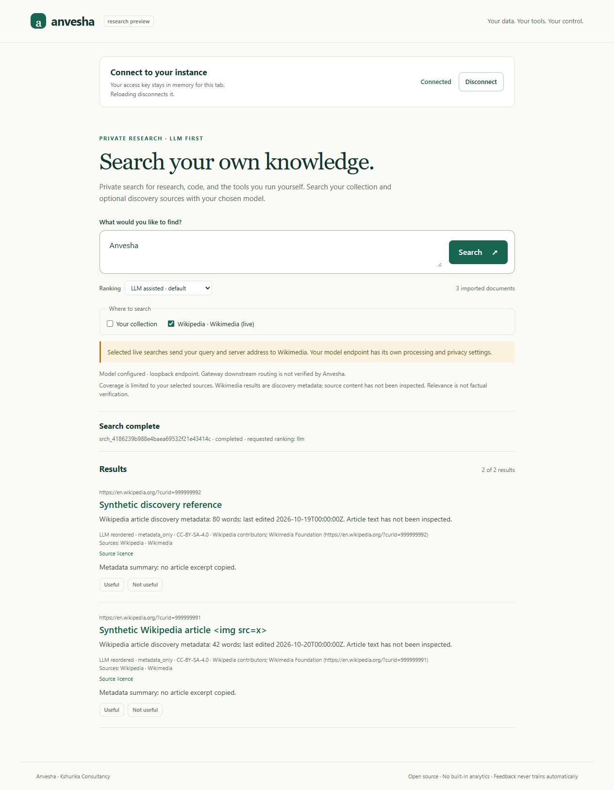

# ANV-028 discovery acceptance

2026-10-20. Started from clean main `3a8c24e`. The user authorized selecting the
next useful improvement, implementation, testing, commit and push. The ledger
preceded behavior changes. Root owns this slice; no subagents were used.

## Decision and actual scope

A ranker cannot recover documents that retrieval never discovers. Add one narrow,
approved source before broader fetching: opt-in English Wikipedia article discovery
metadata, plus existing LLM ranking across approved local/Wikidata/Wikipedia
candidates. Local remains the only implicit/default source. Operator enablement,
client selection and Wikipedia operator identity are explicit.

[ADR 0014](../../decisions/0014-opt-in-wikipedia-discovery.md),
[the operator guide](../../DISCOVERY.md),
[source rights](../../../policies/sources/wikipedia.json) and
[processing policy v6](../../../policies/llm-processing.json) record the boundaries.
The fixed API requests titles, IDs, word count and edit timestamps, never article
prose/API excerpts. Result URLs derive only from validated IDs. Display and
provenance preserve attribution, licence, observation/edit times and the labelled
first-party metadata transformation. Apache code and source content rights remain
separate. Article inspection, general-web coverage and improved relevance are not
established by this slice.

The shared `provider_backoff` table persists Wikimedia 429/503/maxlag waiting
periods across workers and restarts, taking the longest deadline. No automatic
retry loop or reset endpoint. In-flight calls remain possible; ANV-008 retains
strict total deadlines, hosted quotas and concurrency controls. Schema addition
does not rewrite historical jobs, snapshots, feedback or documents. Doctor checks
read-only and old saved files retain their source choices.

## Deterministic and process acceptance

Initial full checks: Ruff passed; 479 tests passed in 63.73s, including 48 new
source/config/worker/API/rights regressions. The only warning was the existing
ANV-015 Starlette/httpx TestClient deprecation. Focused source suite: 48 passed.
Coverage includes malformed/oversized/redirected input; retry seconds/dates and
maxlag; safe error codes; concurrent maximum backoff and exact expiry; legacy
schema/config; disabled sources; empty versus failed discovery; cancellation,
deletion and expiry during retrieval; LLM validation/fallback; licence-preserving
fusion; source-default isolation; authenticated immutable snapshots, idempotency
and feedback. Model protocol fixtures do not prove relevance.

`scripts/smoke_discovery.py` passed offline with separate API and worker processes,
injected fixed-endpoint HTTP transport and a loopback model protocol fixture. It
checks local-only defaults, mixed-source LLM ordering, rights/metadata/no copied
API excerpt, feedback with learning off, API restart, stable snapshots/idempotency,
and persisted throttling across replacement worker processes. Synthetic DB/config,
keys, model fixture and child processes are owned and cleaned. CI now runs it in
the existing Windows/Linux Python 3.12.15/3.14.8 matrix.

Final local acceptance passed:

- `uv sync --extra dev --locked --managed-python`: pinned environment synchronized.
- `uv run --extra dev ruff check .` and `ruff format --check .`: passed, 113 files.
- `uv run --extra dev pytest`: **479 passed in 69.60s**, no skips, the existing
  ANV-015 deprecation warning only.
- `uv run --extra dev python scripts/check_tracking.py` and `git diff --check`:
  passed; final tracking rerun accompanies publication updates.
- All five offline process smokes passed: `smoke_mvp.py`, `smoke_selfhost.py`,
  `smoke_retention.py`, `smoke_sqlite.py` and `smoke_discovery.py`. Owned services,
  synthetic databases/configurations and children cleaned.
- `scripts/check_sqlite_runtime.py --expected-sqlite 3.53.1`: passed on Python
  3.14.8 / SQLite 3.53.1, source ID
  `2026-05-05 10:34:17 c88b22011a54b4f6fbd149e9f8e4de77658ce58143a1af0e3785e4e6475127e9`.
- All five `python -m anvesha.{evaluation,review_data,intent_evaluation,llm_evaluation,ranking_experiment} verify`
  commands passed with unchanged archived fingerprints and zero new judgments.
  These verify historical artifacts, not a new relevance experiment.
- `uv build --out-dir .anvesha/dist/anv028`: wheel/sdist built. Wheel: 31 entries,
  320100 uncompressed bytes; all 11 changed source/browser assets match working
  source. Sdist: 169 entries including new guide, ADR, rights manifest, smoke,
  regressions and evidence/synthetic screenshot. Private DBs/configuration, model
  weights and interpreter binaries are absent.
- Fresh runtime-only venv installed locked hash-verified dependencies and the
  wheel. Imports resolved to site-packages with pytest absent; SQLite was 3.53.1.
  Actual separate-process discovery/LLM-protocol/restart/backoff acceptance passed
  from that installation. New owned installed-package scratch was verified inside
  this workspace before automatic cleanup. No original model cache was involved.

Actual cross-platform/container CI and publication passed as recorded below.
Docker is unavailable locally; actual Linux Compose acceptance ran in CI, not
as a local execution or YAML inspection.

## Real browser acceptance

The new script's explicit synthetic preview served separate temporary data; no
real pilot, review form, key or label was accessed. In the actual in-app browser:

- Connection checked only local, leaving enabled Wikipedia unchecked. Selecting
  Wikipedia showed query/server transmission disclosure; no selection disabled
  Search. Source choices were fixed during work.
- Mixed-source and Wikipedia-only searches completed using the loopback protocol
  fixture. Rights/licence/provider labels and metadata limitations were visible.
  The hostile synthetic `` title was plain text; `#results img` had zero
  nodes. No upstream article/API excerpt was copied.
- One synthetic Useful vote returned learning off. It is operational synthetic
  feedback, never an independent-review judgment.
- Reload removed key/query/results/selections; reconnect again selected only local.
  A 390 by 844 mobile viewport had client/scroll width 375, without horizontal
  overflow. Viewport override was reset, the tab disconnected/closed, and the
  preview stop marker caused graceful process/data cleanup.

This screenshot is an explicitly synthetic protocol fixture, not actual Wikipedia
content, actual model inference or a quality comparison. It contains no usable
credential or private query. Mobile evidence remains in ignored verification
scratch; no production/review data or model weights are distributed.

## Bounded live acceptance and limits

Two explicit, bounded calls used the public fixture query `SQLite`, limit three,
fixed English Wikipedia HTTPS API and identifying
`AnveshaBot/0.1 (https://github.com/Kshurika-Consultancy/anvesha)` User-Agent:

1. Research connectivity/response-shape probe: HTTP 200, 423 bytes, three page
   IDs/titles. No raw response retained.
2. Implemented `search_wikipedia` probe: three validated metadata candidates;
   first title SQLite, with source/attribution/licence/edit time and metadata-only
   label. No raw payload saved or model called.

These demonstrate live connectivity for the bounded query at that time. They do
not measure availability, broad relevance, article truth, completeness or model
quality. No private query was sent. Query/IP/User-Agent transmission to Wikimedia
is separate from local inference and is disclosed before client source selection.

Automatic approval review rejected an additional real-local-model/live-discovery
compatibility run before process creation, with the stated reason **"blocked by
policy"**. It did not start, create the proposed temporary workspace/hardlinks or
change the existing model cache. The rejected action was not retried or worked
around. New-source interoperability with an actual model and any resulting
quality gain therefore remain unverified. Historical ANV-023/024 model evidence
is separate; ANV-020/023 and broader ANV-009/010/011 gates remain open.

## Publication

Implementation `b82915765c585d86c085390c8a989775a6946545` was committed and
pushed to main, with matching local/remote hashes and a clean working tree.
All five jobs passed in [implementation CI](https://github.com/Kshurika-Consultancy/anvesha/actions/runs/39442528908):

- Windows Python 3.12.15: 479 passed in 164.74s; Windows Python 3.14.8: 479 passed
  in 77.26s. Linux Python 3.12.15/3.14.8 passed with 478 tests plus the expected
  Windows-only inherited-handle regression skip. Existing deprecation warning only.
- Each matrix job passed all five process smokes, runtime identity, archived
  verifiers, lint/format/tracking and diff checks. New discovery acceptance stayed
  fully synthetic/offline on every platform.
- Actual Linux Docker Compose acceptance built the current source and passed
  non-root operation, private model network, LLM default, durable restart,
  feedback/fallback and scoped cleanup. Container reported Python 3.14.8 and
  SQLite 3.53.1/source c88b220; no actual model or external discovery was used.

ANV-028's scoped acceptance is complete. This completion-evidence follow-up is
only documentation and has its own CI; inspect current HEAD for that run. Root
ownership of the completed scope is released. No owned test/preview services
remain. Newly owned scratch was cleaned; prior ignored ANV-025 scratch was not
inspected or changed. No public deployment, binary release,
mandatory paid service, automatic training, source auto-enabling or new human
judgment. Actual service DB/configuration and independent-review pilot remain
untouched.
